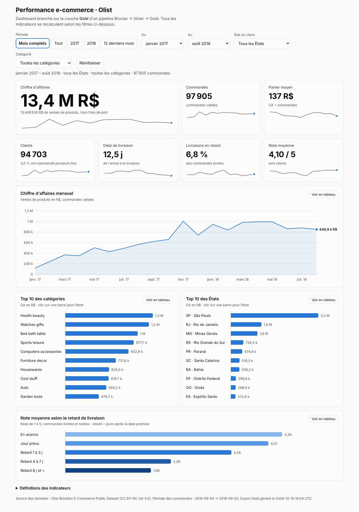
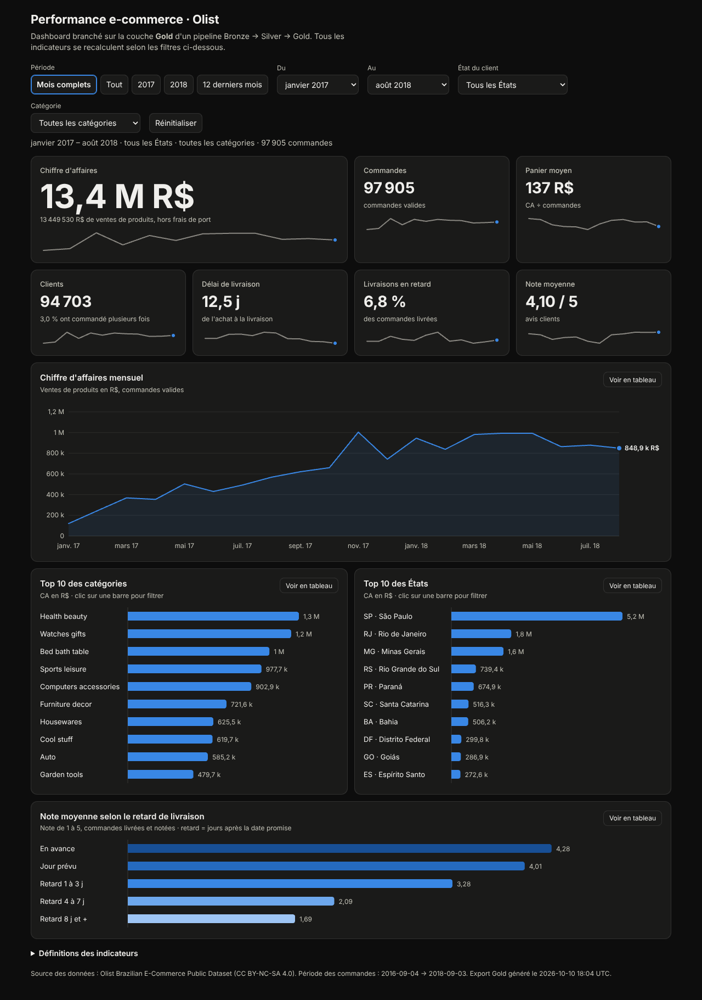
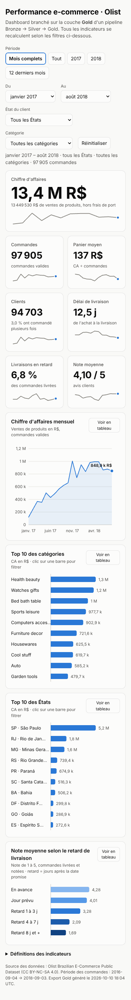
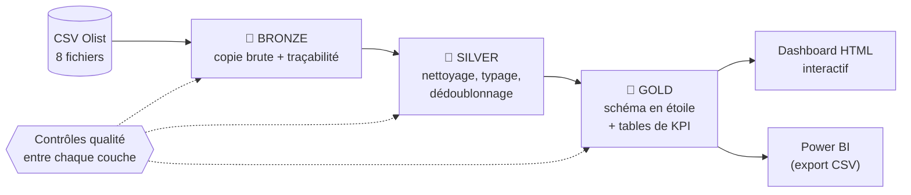

# E-commerce Medallion Pipeline : Bronze → Silver → Gold → Dashboard

Pipeline de données de bout en bout sur **100 000 commandes e-commerce réelles** (Olist, Brésil, 2016-2018) : ingestion brute, nettoyage, modèle en étoile, KPI métier, puis **dashboard interactif** branché sur la couche Gold.

> **Démo en ligne** : https://damienfernandes1996-tech.github.io/ecommerce-medallion-pipeline/ *(disponible après activation de GitHub Pages, voir [Publier le dashboard](#publier-le-dashboard))*



<details><summary>Mode sombre et mobile</summary>





</details>

## Architecture en médaillon



| Couche | Rôle | Ce qui s'y passe | Sortie |
|---|---|---|---|
| **Bronze** | Garder la source telle quelle | Lecture des CSV en texte brut (`all_varchar`), aucune correction. Ajout de `_source_file` et `_ingested_at` pour la traçabilité | `data/bronze/*.parquet` |
| **Silver** | Une base fiable | Typage (dates, nombres), normalisation du texte, dédoublonnage, traduction des catégories, calcul des délais de livraison | `data/silver/*.parquet` |
| **Gold** | Prêt pour le métier | Schéma en étoile (2 faits, 4 dimensions) et 6 tables de KPI pré-calculées | `data/gold/*.parquet`, `outputs/kpi_*.csv` |

Les transformations Silver et Gold sont écrites **en SQL** (dossier [`sql/`](sql/)), exécutées par DuckDB. Python ne fait qu'orchestrer. Détails des choix : [docs/architecture.md](docs/architecture.md) · modèle de données : [docs/data_model.md](docs/data_model.md).

## Ce que disent les données

Chiffres calculés par le pipeline sur la période complète (sept. 2016 – sept. 2018) :

- **13,5 M R$** de ventes de produits (hors frais de port), **98 199 commandes valides**, **94 983 clients**, panier moyen de **137 R$**.
- **Seulement 3 %** des clients commandent plus d'une fois : le modèle repose sur l'acquisition, pas sur la fidélisation.
- **Le retard de livraison détruit la satisfaction** : note moyenne de **4,28** pour une commande livrée en avance, **3,28** avec 1 à 3 jours de retard, **2,09** avec 4 à 7 jours et **1,69** au-delà de 8 jours (79 % de notes de 1 ou 2 sur ces dernières).
- Cela se voit dans le temps : en mars 2018, 19 % des livraisons sont en retard et la note moyenne tombe à 3,74, contre 6 % de retards et 4,28 en août 2018.
- **Forte concentration géographique** : São Paulo pèse 38 % du CA, et SP + RJ + MG 63 %. Les États éloignés sont moins bien servis (Bahia : 19 jours de délai moyen et 12 % de retards, contre 8,7 jours et 4,5 % à São Paulo).
- Le CA mensuel est multiplié par 7 entre janvier 2017 (120 k R$) et août 2018 (849 k R$), avec un pic à 1,00 M R$ en novembre 2017.
- La carte bancaire représente 79 % du CA, le boleto 18 %.

## Indicateurs

| KPI | Définition |
|---|---|
| **Commande valide** | Au moins un article, ni annulée ni indisponible. Tous les KPI portent sur ces commandes |
| **Chiffre d'affaires** | Somme du prix des articles, hors frais de port (R$) |
| **Panier moyen** | CA ÷ nombre de commandes |
| **Clients / taux récurrent** | Clients uniques (`customer_unique_id`) / part ayant au moins 2 commandes valides |
| **Délai de livraison** | Jours entre l'achat et la livraison (commandes livrées) |
| **Taux de retard** | Part des commandes livrées après la date estimée (comparaison au jour près) |
| **Note moyenne** | Moyenne des avis (1 à 5), un avis par commande : le plus récent |
| **Croissance mensuelle** | CA du mois ÷ CA du mois calendaire précédent − 1 |

## Qualité des données

Chaque couche est suivie d'un **contrôle qualité bloquant** : si un test échoue, le pipeline s'arrête et la couche suivante n'est pas construite. Résultat sur les données réelles : **41 contrôles réussis, 1 avertissement, 0 échec** ([`outputs/quality_report.json`](outputs/quality_report.json)).

- Unicité des clés, colonnes obligatoires, intégrité référentielle entre toutes les tables, plages de valeurs (prix ≥ 0, note entre 1 et 5).
- **Réconciliation** : le CA des tables KPI (mensuel, par État, par catégorie, par paiement) égale le CA global au centime près.
- Problèmes réels de la source, traités et documentés :
  - **559 avis en doublon** (même `review_id` ou plusieurs avis pour une commande) : on garde le plus récent par commande.
  - **610 produits sans catégorie** → `unknown`. 2 catégories absentes de la table de traduction, ajoutées à la main.
  - **8 commandes « livrées » sans date de livraison** : signalées (avertissement), exclues des KPI de délai.
  - Colonnes mal orthographiées à la source (`product_name_lenght`) corrigées en Silver.

## Tests

- **14 tests Python** (`pytest`) sur un mini-jeu de données fait main qui contient chaque cas limite (avis en doublon, commande annulée, livraison avant l'achat, catégorie manquante...). Les résultats attendus sont calculés à la main : CA, taux de retard, croissance mensuelle, segmentation des clients.
- **Test de réconciliation JavaScript** : les chiffres que le navigateur recalcule à partir de `data.js` (CA, commandes, clients, retards, notes, par mois, État, catégorie, tranche de retard) sont comparés aux tables Gold.
- Tests de robustesse des contrôles qualité : ils détectent bien un client orphelin ou une clé en double.

## Démarrage rapide

Prérequis : Python 3.10+ (et Node 18+ pour le test JavaScript, optionnel).

```bash
git clone https://github.com/damienfernandes1996-tech/ecommerce-medallion-pipeline.git
cd ecommerce-medallion-pipeline
python -m venv .venv && source .venv/bin/activate     # Windows : .venv\Scripts\activate
pip install -r requirements-dev.txt

python run_pipeline.py        # télécharge les données, construit Bronze → Silver → Gold, exporte le dashboard (~10 s hors téléchargement)
```

Puis ouvrir `dashboard/index.html` dans un navigateur (aucun serveur nécessaire).

```bash
python -m pytest -q                          # tests du pipeline
node --test tests/dashboard_logic.test.js    # le dashboard recalcule bien les chiffres Gold
python run_pipeline.py --stages silver,gold  # rejouer seulement certaines étapes
```

**Données** : `run_pipeline.py` télécharge les CSV depuis un miroir GitHub public du jeu [Olist sur Kaggle](https://www.kaggle.com/datasets/olistbr/brazilian-ecommerce). Si le téléchargement échoue, déposez les 8 fichiers CSV de Kaggle dans `data/raw/` et relancez avec `--skip-download`. Le jeu `geolocation` n'est pas utilisé.

## Publier le dashboard

Le dossier [`dashboard/`](dashboard/) est une page statique autonome (HTML + JS, aucune dépendance externe). Un workflow GitHub Actions la déploie :

1. Pousser le dépôt sur GitHub (branche `main`).
2. *Settings → Pages → Source : **GitHub Actions***.
3. Le dashboard est en ligne à l'adresse `https://<utilisateur>.github.io/<dépôt>/`.

## Dashboard

- **Filtres** : période (préréglages + mois de début/fin), État du client, catégorie. Un clic sur une barre des graphiques « catégories » et « États » filtre aussi tout le reste.
- **7 indicateurs** qui se recalculent exactement (y compris les comptages distincts) : CA, commandes, panier moyen, clients, délai, retards, note, avec une mini-courbe de tendance.
- **4 graphiques** : CA mensuel (survol au clavier ou à la souris), top 10 catégories, top 10 États, note selon le retard de livraison.
- Chaque graphique a sa **vue tableau** (accessibilité), le mode sombre suit le système, la page est utilisable sur mobile.
- Aucune librairie : SVG et JavaScript natifs. Toute la logique de calcul est dans [`dashboard/metrics.js`](dashboard/metrics.js), testée sous Node.

## Power BI

Le dossier [`powerbi/`](powerbi/) explique comment construire le même rapport dans Power BI Desktop à partir du modèle en étoile Gold (`outputs/powerbi/*.csv`, généré par le pipeline), avec les mesures DAX correspondantes.

## Structure du projet

```
├── run_pipeline.py              point d'entrée
├── pipeline/                    orchestration Python (téléchargement, couches, qualité, export)
│   ├── bronze.py  silver.py  gold.py  quality.py  dashboard_export.py  runner.py
├── sql/
│   ├── silver/                  7 fichiers SQL : nettoyage et typage
│   └── gold/                    12 fichiers SQL : dimensions, faits, tables de KPI
├── dashboard/                   index.html, metrics.js, data.js (généré par le pipeline)
├── outputs/                     KPI en CSV (versionnés) + rapport qualité
├── powerbi/                     guide + mesures DAX
├── tests/                       pytest (pipeline) + node:test (dashboard)
├── docs/                        architecture, modèle de données, captures
└── data/                        raw / bronze / silver / gold (reconstruits par le pipeline)
```

## Pistes d'évolution

- Version cloud du même pipeline : BigQuery pour le stockage, dbt pour les transformations, Terraform pour l'infrastructure, Looker Studio pour la restitution.
- Chargement incrémental et orchestration (Airflow, Dagster) plutôt qu'une reconstruction complète.
- Exploiter le jeu `geolocation` (carte du Brésil) et les commentaires des avis (analyse de texte).

## Données et licence

- **Données** : *Brazilian E-Commerce Public Dataset by Olist*, publié par Olist sur Kaggle sous licence **CC BY-NC-SA 4.0** (usage non commercial, attribution, partage dans les mêmes conditions). Les données ne sont pas redistribuées dans ce dépôt.
- **Code** : licence MIT, voir [LICENSE](LICENSE).

*Auteur : Damien Fernandes*
