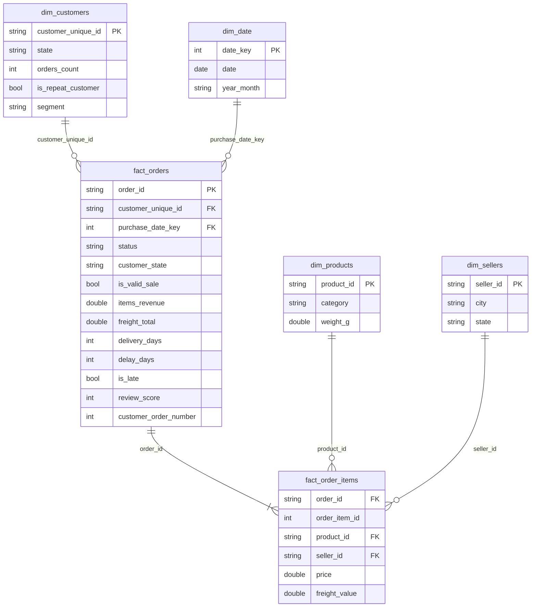

# Modèle de données (couche Gold)

## Schéma en étoile

## Tables de faits

| Table | Grain | Lignes (données réelles) |
|---|---|---|
| `fact_orders` | une commande | 99 441 |
| `fact_order_items` | un article vendu | 112 650 |

Colonnes principales de `fact_orders` :

| Colonne | Description |
|---|---|
| `is_valid_sale` | au moins un article, ni `canceled` ni `unavailable` |
| `items_revenue` / `freight_total` | somme des prix / des frais de port des articles |
| `payment_total`, `installments`, `main_payment_type` | paiement (le type principal = la ligne de plus gros montant) |
| `delivery_days` | jours entre achat et livraison (livrées uniquement) |
| `delay_days` | jours entre la date estimée et la livraison (positif = en retard) |
| `is_late` | `delay_days > 0`, `NULL` si non livrée |
| `review_score` | note de 1 à 5 (un avis par commande) |
| `customer_order_number` | rang de la commande parmi les commandes valides du client (1 = première) |
| `has_date_anomaly` | livraison datée avant l'achat |

## Dimensions

| Table | Clé | Contenu |
|---|---|---|
| `dim_customers` | `customer_unique_id` | État, nombre de commandes valides, dates de première/dernière commande, `segment` (`one_time`, `repeat`, `no_valid_order`) |
| `dim_products` | `product_id` | catégorie (anglais), poids, volume, nombre de photos |
| `dim_sellers` | `seller_id` | ville, État |
| `dim_date` | `date_key` (AAAAMMJJ) | un jour par ligne, sans trou, de la première à la dernière commande |

> Dans Olist, `customer_id` change à **chaque commande** ; c'est `customer_unique_id` qui identifie la personne. Toutes les analyses clients utilisent donc `customer_unique_id`.

## Tables de KPI (prêtes pour la restitution)

| Table | Contenu |
|---|---|
| `kpi_overview` | une ligne : CA, commandes, clients, panier moyen, taux récurrent, délai, retards, note |
| `kpi_monthly` | par mois : CA, commandes, panier, clients, nouveaux clients, délai, retards, note, croissance |
| `kpi_category` | par catégorie : CA, part du CA, commandes, articles, prix moyen, note |
| `kpi_state` | par État : CA, commandes, clients, délai, retards, note |
| `kpi_delivery_review` | note moyenne par tranche de retard (en avance, jour prévu, 1-3 j, 4-7 j, 8 j et +) |
| `kpi_payment` | répartition par moyen de paiement |
